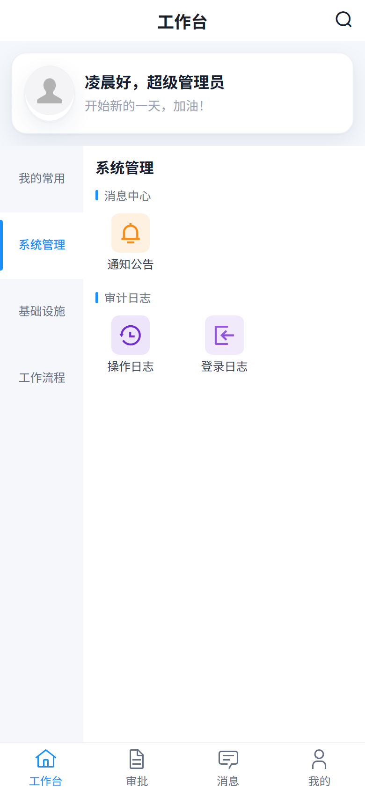
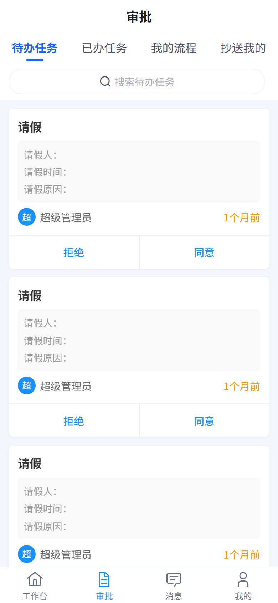
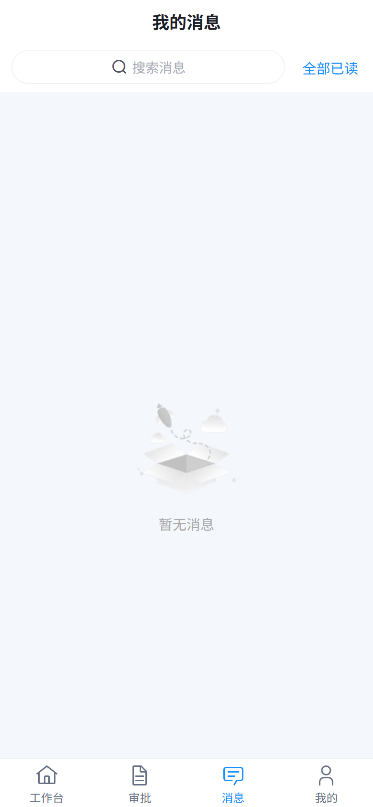
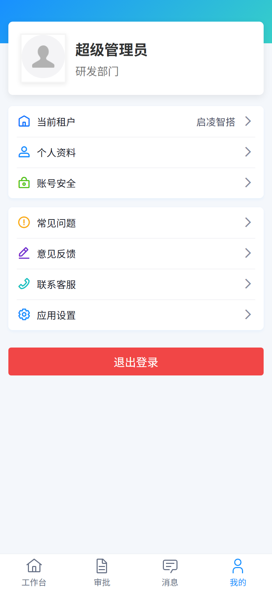

<p align="center">
  
  
  
  
  
  
  
  
</p>

<h1 align="center">启凌智搭 · 移动端（ainb-ui-admin-uniapp）</h1>

<p align="center">
  <b>AI 原生低代码平台</b><br>
  以 AI 为引擎，重新定义企业数字化；让最懂业务的人，自己把应用建出来。
</p>

<p align="center">
  <a href="https://demo.enlev.cn"><b>🔥 在线体验</b></a> &nbsp;|&nbsp;
  <a href="https://doc.enlev.cn"><b>📚 官方文档</b></a> &nbsp;|&nbsp;
  <a href="https://doc.enlev.cn/guide/"><b>使用手册</b></a> &nbsp;|&nbsp;
  <a href="https://doc.enlev.cn/develop/"><b>开发手册</b></a> &nbsp;|&nbsp;
  <a href="https://gitee.com/enlev/ainb"><b>后端仓库</b></a> &nbsp;|&nbsp;
  <a href="https://gitee.com/enlev/ainb-ui-admin-vue3"><b>Web 仓库</b></a>
</p>



**启凌智搭**的移动端不是「另一个后台」，而是同一套后端、同一套权限体系的**第二个运行时宿主**：工作台 / 审批 / 消息 / 我的四个 tab，加上在线表单与 BPM 审批的移动端运行时。工作台上有哪些菜单**不在前端写死**——由服务端分端导航树 `system_nav_node` 按当前用户的授权下发，换一个人登录就是另一张工作台。

---

## 🐶 新手必读

- **Node ≥ 20 && pnpm ≥ 9**（🔴 **强制使用 pnpm**，`preinstall` 里 `npx only-allow pnpm` 直接拦下 npm / yarn）
- **在线体验**：<https://demo.enlev.cn>（Web 端；移动端 H5 本地 `pnpm dev` 起在 9000 端口）
- **官方文档**：<https://doc.enlev.cn>
- **后端仓库**：[ainb](https://gitee.com/enlev/ainb)　**Web 仓库**：[ainb-ui-admin-vue3](https://gitee.com/enlev/ainb-ui-admin-vue3)
- **五分钟跑起来**：见下文 [🚀 快速开始](#-快速开始)

### 平台兼容性

沿用 uni-app 的多端能力，命令行即可运行，**无需 HBuilderX**：

| H5 | iOS | Android | 微信小程序 | 支付宝小程序 | 字节小程序 | 百度小程序 | 钉钉小程序 | 快手小程序 | QQ 小程序 |
|:--:|:---:|:-------:|:-----:|:------:|:-----:|:-----:|:-----:|:-----:|:------:|
| ✅  |  ✅  |    ✅    |   ✅   |   ✅    |   ✅   |   ✅   |   ✅   |   ✅   |   ✅    |

> 本仓库**实际持续验证的是 H5 与微信小程序**两条线；其余端由 uni-app 编译能力覆盖，未逐端回归。

### 演示账号

与 Web 端共用同一套账号体系（SaaS 多租户 + 资源授权），密码均为 `admin123`：`admin`（超管）/ `docadmin`（租户管理员）/ `docsales`（行级权限销售）等，完整清单见 [Web 仓库 README](https://gitee.com/enlev/ainb-ui-admin-vue3#-新手必读)。

> 🔴 移动端工作台菜单由服务端按授权下发，**超管与普通员工看到的工作台完全不同**——验证导航与权限表现请换非超管账号。

---

## 🐯 平台简介

在上游 unibest 工程骨架与芋道移动端业务页之上，本仓库是**启凌智搭产品三仓之一**：

| 能力 | 一句话 | 代码位置 |
| --- | --- | --- |
| ★ **服务端驱动工作台** | 导航树 `system_nav_node` 按端（`terminal=app`）+ 按授权下发，前端零硬编码菜单 | `src/store/nav.ts`、`src/api/system/navNode/` |
| ★ **在线表单移动端运行时** | 消费 Web 表单设计器产出的 rule JSON，自研渲染器映射到 wot-design-uni | `src/pages-bpm/components/form-create/` |
| ★ **BPM 审批移动端** | 待办 / 已办 / 我的流程 / 抄送，审批详情内嵌表单渲染与审批意见 | `src/pages-bpm/` |
| ★ **品牌令牌与硬编码色守卫** | 品牌色收敛为 SCSS 变量 + TS 令牌，CI 级脚本禁止散落硬编码色 | `src/style/tokens.scss`、`scripts/check-hardcoded-color.mjs` |
| **请求封装与双 token** | 拦截器链：租户头 → Bearer → API 加解密；401 静默刷新并重放排队请求 | `src/http/`、`src/store/token.ts` |
| **约定式路由** | 文件系统即路由，`definePage` 声明页面元信息，`pages.json` 为生成产物 | `@uni-helper/vite-plugin-uni-pages` |

- **技术栈**：Vue 3.4 + uni-app 3.0 + Vite 5.2 + TypeScript 5.8 + Pinia 2 + wot-ui 2 + z-paging 2.8 + UnoCSS 66
- **权限**：与 Web 端同一套后端决策；移动端额外由导航树在「入口」层面收敛，页面级另有登录拦截
- **多租户**：登录页租户选择器，请求自动带 `tenant-id` / `visit-tenant-id`
- **国际化**：内置 `zh-CN` / `en` 两套（`vue-i18n`）
- **组件**：wot-ui 全量按需 + 自研 `yd-*` 8 个 + `system-select` 5 个 + `dict-tag`

---

## 🐳 项目关系

| 仓库 | 技术栈 | 说明 |
| --- | --- | --- |
| **ainb** | Java 17 + Spring Boot 3.5 + Maven | 后端服务，端口 48080，接口前缀 `/admin-api` |
| **ainb-ui-admin-vue3** | Vue 3.5 + Vite 8 + Element Plus | Web 管理端，`pnpm dev` 起在 80 端口 |
| **ainb-ui-admin-uniapp**（本仓库） | Vue 3.4 + uni-app 3.0 + Vite 5.2 + wot-ui | 移动端，H5 起在 9000 端口，另出微信小程序 / App 产物 |

三端**共用同一个后端、同一套 `/admin-api`、同一套权限体系与租户**；移动端不拥有任何私有接口契约，接口能力以 Web 端已在用的为准。

🔴 **移动端不走 Vite proxy**：H5 直连 `VITE_SERVER_BASEURL`（开发态 `http://localhost:48080/admin-api`），后端已支持跨域。**微信小程序 / App 端没有跨域概念，但要求后端域名在小程序后台配置 request / uploadFile / socket 合法域名白名单**，否则真机请求被平台拦截。

---

## 😎 开源协议

本项目采用比 Apache 2.0 更宽松的 **[MIT License](./LICENSE)** 开源协议：

① **个人与企业可 100% 免费使用**，可自由复制、修改、分发，也可用于商业用途。

② **代码全部开源**，不区分社区版与商业版——服务端驱动导航、在线表单移动端运行时这些自研界面全在仓库里，没有混淆产物、没有授权校验。

③ **归属有据可查**：本仓库派生自芋道 `yudao-ui-admin-uniapp` 与 `unibest` 骨架，并随产物分发 uni-app（Apache-2.0）、wot-ui、z-paging 等第三方组件；MIT **只覆盖本仓库自身代码**，第三方组件按其原始协议授权。协议全文见 [`licenses/`](./licenses/)，逐组件清单见 [`THIRD-PARTY-NOTICES.md`](./THIRD-PARTY-NOTICES.md)。

---

## 🐼 内置功能

按 `src/pages-*` 分包**如实**列出。已交付 = 后端模块存在、导航可到达、页面可用；未交付 = 页面文件来自上游但后端无对应模块、App 菜单已裁掉，**不要以为它们能用**。

### 已交付（6 个分包，389 个页面文件）

| 分包 | 页面文件数 | 内容 |
| --- | --- | --- |
| `src/pages` | 28 | 主包：工作台（4 种布局）、工作台搜索 / 设置、审批、消息、我的、联系客服 |
| `src/pages-core` | 24 | 登录 / 验证码登录 / 三方登录、错误页、个人资料、账号安全、FAQ、意见反馈、设置 |
| `src/pages-system` | 120 | 系统管理：用户 / 部门 / 岗位 / 角色 / 菜单 / 字典 / 通知公告 / 日志 / 租户等 |
| `src/pages-infra` | 62 | 基础设施：文件管理、定时任务、代码生成、API 访问日志等 |
| `src/pages-bpm` | 69 | 工作流程：我的 / 待办 / 已办 / 抄送、流程模型、审批详情、**在线表单渲染器** |
| `src/pages-ai` | 86 | AI：助手对话、知识库、模型 / 工具 / 提示词管理、音乐 / 绘图等玩法页 |

### 未交付（10 个分包，1055 个页面文件）——上游遗留，后端已裁掉对应 App 菜单

`pages-crm`、`pages-erp`、`pages-im`、`pages-iot`、`pages-mall`、`pages-member`、`pages-mes`、`pages-mp`、`pages-pay`、`pages-wms`。

后端只有 `enlev-module-{system, infra, bpm, ai, agent}` 五个业务模块，上述分包的接口**不存在**；后端提交 `c768ef8473` 已把 App 菜单下这 10 组未交付模块裁掉，因此工作台不会露出它们。文件保留是为了后续按需接通时不丢上游实现，**接入前请先确认后端模块已落地**。

### 半损坏（1 个分包）

`pages-statistics`（27 个页面文件）：其 API import 指向 crm / erp / iot / mes / wms / mall 等未交付模块，仅 infra 相关 2 个页面可能存活。**默认不要引用该分包**。

---

## 🐨 技术栈

| 框架 | 说明 | 版本 |
| --- | --- | --- |
| [Vue](https://vuejs.org/) | 渐进式 JavaScript 框架 | 3.4.x |
| [uni-app](https://uniapp.dcloud.io/) | 跨平台应用开发框架 | 3.0.x |
| [TypeScript](https://www.typescriptlang.org/) | JavaScript 的超集 | 5.8.x |
| [Vite](https://vitejs.dev/) | 构建工具 | 5.2.x |
| [Pinia](https://pinia.vuejs.org/) | Vue 状态管理（含 `pinia-plugin-persistedstate` 持久化） | 2.0.x |
| [wot-ui](https://wot-ui.cn/) | UI 组件库（`@wot-ui/ui`） | 2.2.x |
| [z-paging](https://z-paging.zxlee.cn/) | 高性能分页 / 下拉刷新组件 | 2.8.x |
| [UnoCSS](https://unocss.dev/) | 即时原子化 CSS 引擎 | 66.x |
| [vue-i18n](https://vue-i18n.intlify.dev/) | 国际化 | 9.1.x |
| [unibest](https://github.com/feige996/unibest) | 工程骨架（约定式路由 / layout / 请求封装的底座） | 4.1.0 |
| [echarts](https://echarts.apache.org/) | 图表（仅 `pages-statistics` 分包在用，该分包当前半损坏） | 5.6.x |

### 目录结构

```
ainb-ui-admin-uniapp/
├── env/                      # .env / .env.development / .env.test / .env.production（叠加顺序见「环境变量」）
├── scripts/                  # create-base-files、upload-weixin、check-hardcoded-color 等
├── src/
│   ├── api/                  # 接口层，与后端 /admin-api 一一对应
│   ├── components/
│   │   ├── yudao-ui/         # 自研 yd-* 8 个（目录名沿用上游，见「工程约定」）
│   │   ├── system-select/    # 用户 / 部门选择器 5 个
│   │   └── dict-tag/         # 字典标签
│   ├── http/                 # 请求封装、拦截器、SSE
│   ├── layouts/              # tabbar / 默认布局
│   ├── pages/                # 主包：工作台 / 审批 / 消息 / 我的 / 客服
│   ├── pages-core/           # 登录与个人中心等核心页
│   ├── pages-system/ …       # 业务分包（见「内置功能」）
│   ├── router/               # 登录拦截与路由配置
│   ├── store/                # token / user / nav（服务端导航树）/ dict 等
│   ├── style/                # tokens.scss（品牌令牌）、theme.ts
│   ├── tabbar/               # tabbar 策略与配置（CUSTOM_TABBAR_WITH_CACHE）
│   └── utils/                # 加解密、下载、上传、日期等
├── vite-plugins/             # copy-native-resources 等自定义插件
├── pages.config.ts           # globalStyle / easycom / tabbar 入口
├── uno.config.ts             # UnoCSS 配置（含本地 my-icons 图标集）
└── vite.config.ts            # UniPages / UniComponents / UniLayouts / UniManifest 装配
```

> `src/pages.json` 与 `src/manifest.json` 是**生成产物**（已 gitignore），由 `pages.config.ts` + 各页 `definePage` 在 dev / build 时生成，不要手改。

---

## 🚀 快速开始

```bash
# 1. 安装（只能 pnpm；preinstall 会拦下 npm/yarn）
pnpm install

# 2. H5（默认，9000 端口）
pnpm dev

# 3. 微信小程序（产物在 dist/dev/mp-weixin，用微信开发者工具打开）
pnpm dev:mp-weixin

# 4. App
pnpm dev:app
```

前置条件：本地后端 `ainb` 已起在 48080（MySQL 3306 + Redis 6379），否则登录与所有列表页都会失败。

### 验证跑通了

| 检查点 | 预期 |
| --- | --- |
| 打开 `http://localhost:9000` | 跳到登录页，品牌名「启凌智搭」，租户选择器默认选中「启凌智搭」 |
| 用户名 / 密码输入框 | 已按 `env/.env` 的 `VITE_APP_DEFAULT_LOGIN_*` 预填 `admin` / `admin123` |
| 点「登录」 | 进入工作台，Network 面板请求打到 `http://localhost:48080/admin-api/**` |
| 工作台菜单 | 来自 `GET /admin-api/system/nav-node/tree?terminal=app`，非超管账号菜单更少 |
| 微信小程序真机 | 需在开发者工具「详情 → 本地设置」勾选**不校验合法域名**，否则请求被拦 |

---

## 📜 脚本清单

| 命令 | 作用 |
| --- | --- |
| `pnpm dev` / `dev:h5` | H5 开发态，9000 端口 |
| `pnpm dev:mp-weixin` | 微信小程序开发态 |
| `pnpm dev:app` | App 开发态 |
| `pnpm build:h5` / `build:mp-weixin` / `build:app` | 各端生产构建，产物在 `dist/build/<platform>` |
| `pnpm build:test` / `build:prod` | 按 `test` / `production` mode 构建（叠加对应 env 文件） |
| `pnpm upload:mp-weixin` | 小程序 CI 上传（读 `VITE_WX_APPID` 与私钥路径，版本号回退 `package.json` 的 `yudao-version`） |
| `pnpm type-check` | `vue-tsc --noEmit` 全量类型检查 |
| `pnpm lint` / `lint:fix` | ESLint（带缓存） |
| `pnpm check:color` | 硬编码色守卫：禁用色必须 0 命中，品牌色配额超限即 exit 1 |
| `pnpm init-baseFiles` | 生成 `pages.json` / `manifest.json` 占位（`predev` 自动执行） |

---

## 🏗️ 核心能力详解

### ★ 服务端驱动的工作台导航

Web 端的菜单在 `system_menu`，移动端**不复用**它：移动端工作台消费的是分端导航树 `system_nav_node`（`terminal=app` 的自引用树）。

```
后端 system_nav_node 表
   └─ GET /admin-api/system/nav-node/tree?terminal=app   （服务端已按授权过滤）
        └─ src/api/system/navNode/  getNavTree('app')
             └─ src/store/nav.ts    useNavStore（持久化，失败保留旧树）
                  └─ src/pages/index/**  4 种布局（section / accordion / sidebar / tabs，工作台设置页可切换并持久化）
```

- 服务端返回的就是「该用户在本端能看到的树」，**前端不再做权限白名单二次过滤**；
- 登录成功后 `loadNavTree(true)` 强制刷新；工作台 `onShow` 走 `loadNavTree(false)` 兜底重试；
- 拉取失败**保留已持久化的旧树**、不清空不抛出——避免网络抖动导致工作台空白或登录中断；
- 节点的 `route` 必须命中 `pages.json`，`onlyPc` 节点点击跳提示页，`query` 承载在线表单 `code=xxx` 这类页面参数；
- Web 侧的维护入口是「移动端导航」树编辑器与「App 菜单」页，改完移动端下次登录即生效。

### ★ 在线表单的移动端运行时

Web 表单设计器产出的 rule / option JSON，在移动端由 `src/pages-bpm/components/form-create/` 这套**自研渲染器**消费（`packages/{core, utils, wot-ui}`，rule 的 `type` 多层分派到 wot-design-uni 组件），BPM 审批详情 / 发起 / 审批意见页都在用它。

🔴 **控件覆盖与 Web 端存在代际差**：以 Web 的组件契约 `form-widget-contracts.json`（contractVersion 2，55 个 `supported` 控件）为唯一事实来源核对，移动端**已覆盖 42、缺 12、1 个待核实**。缺的 12 个里包含主干控件 `OrgPicker`（组织选择器）/ `RemotePicker`（远程选择器）/ `RelationForm`（关联表单）——**今天在 Web 新建的在线表单一旦用到这三者，移动端必然显示「暂不支持」**。补齐顺序与机制（契约副本 + 对齐测试）见开发手册移动端章与仓库根目录的优化方案文档。

### ★ 请求封装与双 token

`src/http/interceptor.ts` 的拦截器链（顺序敏感）：query 序列化 → H5 代理 / baseUrl 分支（条件编译）→ 60s 超时 → 白名单（`/login`、`/refresh-token`、租户名查 id）否则加 `Bearer` → 租户头 `tenant-id` / `visit-tenant-id`（`VITE_APP_TENANT_ENABLE=true` 时）→ API 加解密（`VITE_APP_API_ENCRYPT_*`，与 Web 同口径）。

- 401 走 `src/http/http.ts` 的静默刷新：`refreshing` 标志 + 任务队列，刷新成功后**重放排队请求**，不弹登录页；
- 双 token 模式由 `VITE_AUTH_MODE=double` 开启，`src/store/token.ts` 的 `refreshToken` 处理 `isDoubleTokenRes`；
- 页面级登录拦截在 `src/router/interceptor.ts`，白名单的真实来源是各页 `definePage({ excludeLoginPath: true })`，`src/router/config.ts` 里的 `EXCLUDE_LOGIN_PATH_LIST` 只是补充样例。

### ★ 品牌令牌与硬编码色守卫

品牌色只允许出现在 `src/style/tokens.scss`（SCSS 变量）与 `src/style/theme.ts`（TS 令牌）两处；`pnpm check:color` 扫描全仓：禁用色（上游品牌蓝 `#3370ff`）必须 0 命中，本品牌色 `#1890ff` 的散落用量有配额基线，超限即 exit 1。页面里写颜色请走 `var(--brand-*)` 或 UnoCSS 令牌类。

---

## 🛠️ 工程约定

- **约定式路由**：`src/pages*/**/*.vue` 即路由；页面元信息（标题、`navigationStyle`、`excludeLoginPath`）用 `definePage({...})` 声明；`src/pages.json` 为生成产物。
- **分包**：主包只放 tabbar 四页（工作台 / 审批 / 消息 / 我的）与客服页，登录链路在 `pages-core`，业务一律进 `pages-*` 分包（`vite.config.ts` 的 `UniPages.subPackages` 登记）；小程序主包有 2MB 限制，新增主包文件要掂量。
- **easycom**（`pages.config.ts`，改完需重启 dev）：
  - `^yd-(.*)` → `@/components/yudao-ui/yd-$1/yd-$1.vue`（自研 8 个）
  - `^wd-(.*)` → `@wot-ui/ui/components/wd-$1/wd-$1.vue`
  - `^fg-(.*)` → `@/components/fg-$1/fg-$1.vue`（unibest 骨架组件）
  - `z-paging` 用负向前瞻排除 `z-paging-refresh` / `z-paging-load-more`
- **`src/components/yudao-ui/` 目录名刻意不改**：它牵连 56 个文件的 import、easycom 规则与自动生成的 `local-components.d.ts`，改名收益为零、风险面大；上游署名仅保留在目录名这一层。
- **tabbar**：策略 `CUSTOM_TABBAR_WITH_CACHE`（自定义 + 缓存），配置在 `src/tabbar/config.ts`；**改完该文件必须重启 dev**，否则 `pages.json` 不更新、配置不生效。
- **代码风格**：ESLint 9 + `@uni-helper` 规则集；提交走 husky + lint-staged + commitlint（本仓 commitlint 已放宽为全角 / 半角分隔符都收，见 `.commitlintrc.cjs`）。

---

## 🌍 环境变量与构建

叠加顺序：`env/.env` → `env/.env.<mode>`（`development` / `test` / `production`），后者覆盖前者。`pnpm dev` 的 mode 是 `development`。

| 变量 | 作用 | 注意 |
| --- | --- | --- |
| `VITE_APP_TITLE` / `VITE_APP_PORT` | 应用名 / H5 端口 | 默认「启凌智搭」/ 9000 |
| `VITE_SERVER_BASEURL` | 后端地址（含 `/admin-api`） | 生产为 `https://demo.enlev.cn/admin-api` |
| `VITE_STATIC_BASEURL` | `/static/` 静态资源的域前缀 | **留空**即走应用自身；填上游域名会把资源指到别处 |
| `VITE_APP_PUBLIC_BASE` | H5 部署公共路径 | nginx 子路径部署时改 |
| `VITE_AUTH_MODE` | `single` / `double` token | 与后端配置必须一致 |
| `VITE_APP_TENANT_ENABLE` | 多租户开关 | 关则不带租户头 |
| `VITE_APP_API_ENCRYPT_*` | 接口加解密 | 与 Web 同口径，密钥换端需同步 |
| `VITE_APP_DEFAULT_LOGIN_*` | 登录页预填租户 / 账号 / 密码 | 仅开发便利，生产 env 不填 |
| `VITE_APP_SERVICE_QRCODE` / `VITE_APP_SERVICE_PHONE` / `VITE_APP_SERVICE_TIME` | 联系客服页二维码 / 电话 / 服务时间 | **留空即优雅降级**：不渲染裂图、隐藏拨打入口 |
| `VITE_WX_APPID` / `VITE_UNI_APPID` | 小程序 / uni appid | 上传 CI 必需 |
| `VITE_COPY_NATIVE_RES_ENABLE` | App 构建时复制根目录 `nativeplugins/` | 仅 `UNI_PLATFORM=app` 生效 |

多端产物位置：`dist/build/h5`、`dist/build/mp-weixin`、`dist/build/app`（开发态在 `dist/dev/<platform>`）。H5 部署到 nginx 子路径时同时改 `VITE_APP_PUBLIC_BASE` 与 `try_files`。

---

## 🧪 校验

**如实说明：本仓库当前没有单元测试。** 可用的校验手段只有三条：

| 命令 | 覆盖 |
| --- | --- |
| `pnpm type-check` | `vue-tsc --noEmit`，全量类型 |
| `pnpm lint` | ESLint 全仓 |
| `pnpm check:color` | 硬编码色守卫 |

改动后的验证以「起 H5 手动点受影响页面」为准；跨端改动至少补一次微信小程序编译（`pnpm build:mp-weixin`）确认条件编译分支没坏。补测试体系是已知欠账，不在本 README 假装存在。

---

## 🐷 演示图

下列截图为本地 H5（9000）+ 本地后端（48080）以超管账号实拍的当前版本，非上游素材：

| 工作台（服务端下发导航） | 审批（待办） |
|:--:|:--:|
|  |  |

| 消息 | 我的 |
|:--:|:--:|
|  |  |

> `.image/admin-uniapp/` 与 `.image/common/` 下是上游芋道的历史素材，本 README 不引用；重拍脚本与原始产物在工作区 `_evidence/`（不入库）。

---

## 🧭 常见坑速查

| 症状 | 根因与解法 |
| --- | --- |
| z-paging 列表高度塌陷 / 滚不动 | 父容器没给确定高度；z-paging 需要占满剩余空间，套 `flex-1` 或显式 `height` |
| 巡检脚本报「页面栈超 10 层」 | uni-app 平台硬上限就是 10 层；连续 `navigateTo` 要改 `redirectTo`，巡检假阳性多源于此 |
| 改了 `src/tabbar/config.ts` 不生效 | `pages.json` 是生成产物，必须重启 dev |
| 图片 / 静态资源 404 或指到别家域名 | `VITE_STATIC_BASEURL` 会被拼到 `/static/...` 前面；留空走应用自身 |
| 小程序真机请求全失败 | 后端域名未进小程序后台 request / uploadFile 白名单；开发期勾「不校验合法域名」 |
| 控制台有 eruda 调试球 | 仅开发态注入（`vite.config.ts`），生产构建不带 |
| `type-check` 报找不到组件 / 类型 | `src/types/*.d.ts` 由 dev server 生成；先跑一次 `pnpm dev` 再 `type-check` |
| `pnpm dev` 起不来或 `pages.json` 缺失 | 先 `pnpm init-baseFiles`（正常 `predev` 会自动跑） |
| 合并上游 unibest 冲突一片 | 按 `docs/merge/README.md` 的按月推进法，冲突面集中在 `vite.config.ts` / `pages.config.ts` / `src/http/` |

---

## 📚 文档

| 入口 | 内容 |
| --- | --- |
| [使用手册](https://doc.enlev.cn/guide/) | 面向使用者：每页配实测截图与多视角对照 |
| [开发手册](https://doc.enlev.cn/develop/) | 面向开发者：三仓架构、机制与操作；**移动端章**覆盖环境、结构、请求与登录态、页面范式、nav-node 全链路、在线表单、多端发布与坑位 |
| [后端仓库](https://gitee.com/enlev/ainb) | Java 17 + Spring Boot 3.5，接口与权限的实现侧 |
| [Web 仓库](https://gitee.com/enlev/ainb-ui-admin-vue3) | 管理后台前端，表单 / 门户设计器与资源授权所在 |

---

## 🙏 鸣谢

- [yudao-ui-admin-uniapp](https://gitee.com/yudaocode/yudao-ui-admin-uniapp)：移动端业务页底座（MIT）
- [unibest](https://github.com/feige996/unibest) · 菲鸽：工程骨架与约定式路由底座（MIT）
- [wot-design-uni](https://github.com/wot-ui/wot-ui)：UI 组件库（MIT）
- [z-paging](https://z-paging.zxlee.cn/)：分页与下拉刷新（MIT）
- [form-create](https://github.com/xaboy/form-create) · xaboy：在线表单 rule 协议模型（MIT；本仓为其规则模型的独立 uni-app 实现，非源码副本）
- [uni-app](https://uniapp.dcloud.io/) · DCloud：跨端编译（Apache-2.0）

完整归属与协议全文见 [`licenses/`](./licenses/) 与 [`THIRD-PARTY-NOTICES.md`](./THIRD-PARTY-NOTICES.md)。

---

## 📄 许可证

[MIT](./LICENSE) © 2026 启凌
